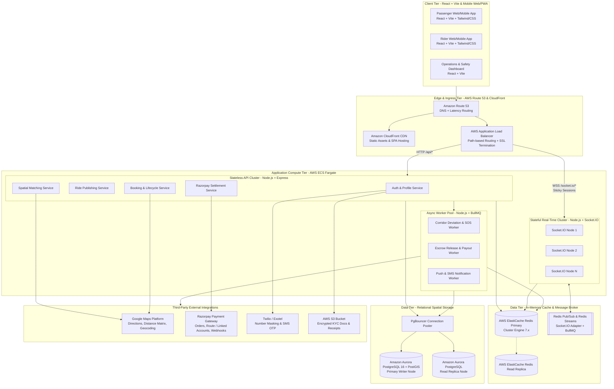
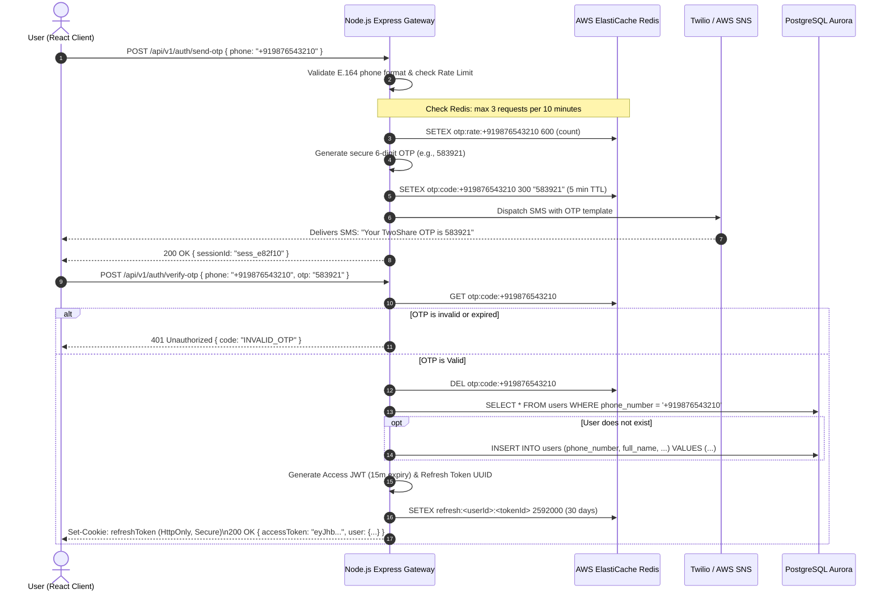
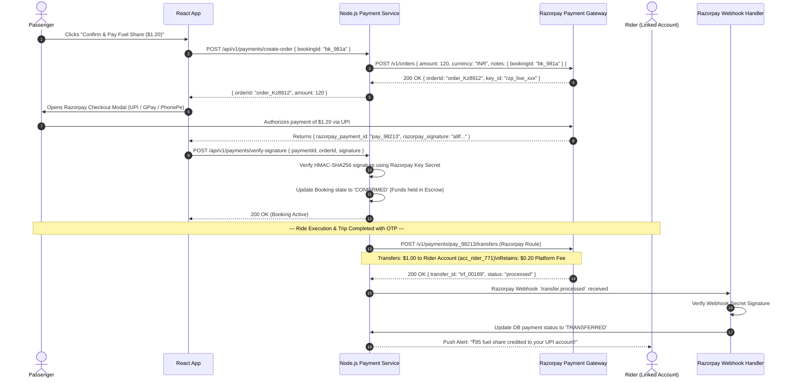
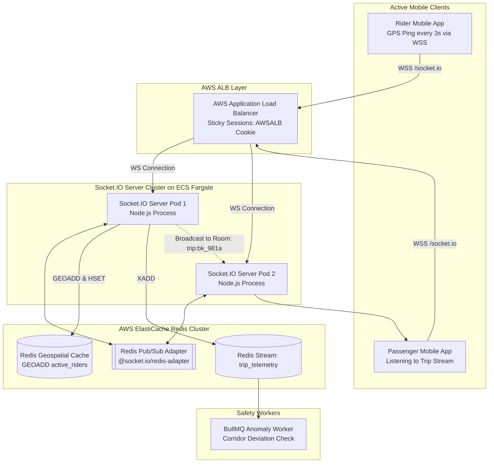
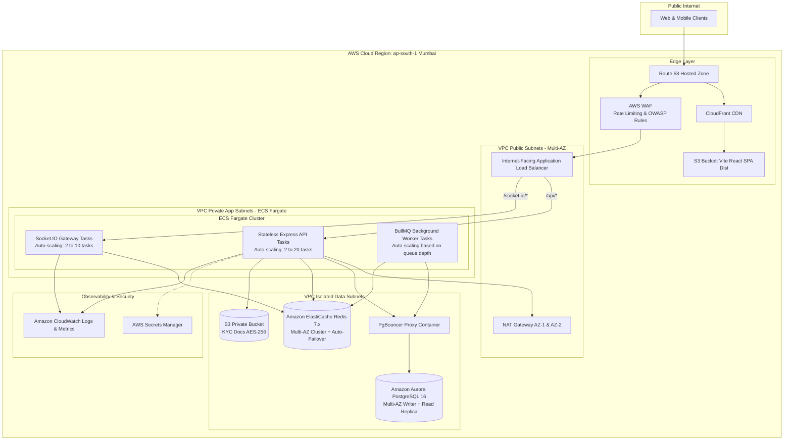

# System Architecture Document
# Platform: TwoShare (Intra-City Urban Bike Pooling Platform)
**Version:** 1.0.0  
**Architect:** Senior Software Architect  
**Status:** Approved for Engineering Implementation  
**Tech Stack:** React + Vite, Node.js + Express, PostgreSQL (PostGIS), Redis, Socket.IO, Google Maps Platform, Razorpay, Amazon Web Services (AWS)

---

## Executive Summary
This document specifies the end-to-end technical architecture for **TwoShare**, an intra-city peer-to-peer bike pooling platform. Unlike inter-city carpooling (e.g., BlaBlaCar) where rides are scheduled days in advance over simple highway waypoints, intra-city bike pooling operates under high-frequency spatial-temporal constraints: dynamic traffic congestion, minute-level departure tolerances, walking-distance curbside pickups, low-latency spatial matching, and real-time GPS telemetry tracking.

The architecture emphasizes sub-second corridor matching, high-concurrency WebSocket telemetry with minimal battery and network overhead, automated escrow settlement via Razorpay, and high availability on AWS.

---

## 1. High-Level Architecture

The system follows a multi-tier, event-driven architecture designed to separate stateless compute workloads (HTTP API, matching logic) from stateful, long-lived connections (Socket.IO telemetry) and asynchronous background tasks (geofence monitoring, notifications, payouts).

### 1.1 High-Level System Architecture Diagram



### 1.2 Core Architectural Principles
1. **Stateless API Services:** The REST API tier (Node.js/Express) maintains zero session state in local memory. All authentication relies on cryptographically verified JWT tokens, and transient state resides in Redis.
2. **Dedicated Real-Time Gateway:** Socket.IO instances are separated into their own dedicated auto-scaling cluster behind the ALB to prevent connection-holding and WebSocket upgrades from starving standard HTTP API threads.
3. **Decoupled Spatial Compute:** Route polyline decoding and spatial intersection checks are executed in PostgreSQL with PostGIS C-extensions (`ST_DWithin`, `ST_Distance`) rather than inefficient Node.js event-loop operations.
4. **Resilient Asynchronous Processing:** Non-critical workflows (push notifications, SMS, anomaly verification, escrow release) are offloaded to Redis-backed queues (BullMQ) with automated retry and dead-letter queue (DLQ) capabilities.

---

## 2. Microservices vs. Monolith Analysis

A critical architectural decision for an early-to-growth stage startup is selecting the right architectural granularity.

### 2.1 Comparative Trade-Off Matrix

| Evaluation Dimension | Pure Microservices Architecture | Modular Monolith (Chosen for Phases 1–2) | Traditional Unstructured Monolith |
| :--- | :--- | :--- | :--- |
| **Development Velocity (Initial 12 mo)** | **Low:** Heavy DevOps overhead, multiple CI/CD pipelines, inter-service contracts. | **Very High:** Single repository, shared TypeScript types, single deployment pipeline. | **High:** Quick prototyping, but degenerates rapidly into spaghetti code. |
| **Latency & Performance** | **Moderate:** Network serialization (JSON/gRPC) across 5–8 hops per user request. | **Extremely Low:** In-process function calls and zero cross-service network serialization. | **Low:** Low network overhead, but prone to lock contention and memory bloat. |
| **Operational & Infra Cost** | **High:** Multiple ECS tasks, internal load balancers, distributed tracing (Jaeger/Zipkin). | **Low:** Minimal container instances (API + Socket + Worker), lower AWS bill. | **Lowest:** Single deployment instance, but impossible to scale isolated hot paths. |
| **Data Consistency & Transactions** | **Complex:** Distributed transactions (Saga pattern), eventual consistency, two-phase commits. | **Simple & ACID Compliant:** Native PostgreSQL transactions (`BEGIN...COMMIT`) across domain boundaries. | **Simple:** Database-level ACID transactions. |
| **Scalability of Hot Paths** | **High:** Can scale ride matching independently from user profile service. | **High (Hybrid):** Separate deployments of the *same codebase* into `API`, `Socket`, and `Worker` roles. | **Poor:** Entire application must scale together, leading to wasteful resource utilization. |

### 2.2 Architectural Recommendation: The Domain-Driven Modular Monolith
TwoShare adopts a **Modular Monolith** pattern organized into isolated domain contexts, deployed as specialized workload containers (API Web, Real-Time Socket, Async Queue Worker).

```
src/
├── modules/
│   ├── auth/                  # Phone OTP, JWT, KYC verification
│   ├── users/                 # Profiles, Emergency Contacts, Vehicles
│   ├── rides/                 # Publishing routes, recurring schedules, waypoints
│   ├── matching/              # PostGIS spatial queries, detour scoring
│   ├── bookings/              # State machine (REQUESTED -> STARTED -> COMPLETED)
│   ├── tracking/              # Socket.IO handlers, Redis location caching
│   ├── payments/              # Razorpay Orders, Route splits, Webhook handlers
│   └── safety/                # SOS triggers, Geofence deviation monitor
├── shared/
│   ├── database/              # PostgreSQL (Kysely/Prisma) connection & migrations
│   ├── redis/                 # Redis client, distributed locks, BullMQ queues
│   ├── errors/                # Standardized domain error classes
│   └── utils/                 # Spatial math, crypto helpers, validation
├── server.ts                  # HTTP API entry point (Express)
├── socket-server.ts           # Real-time WebSocket entry point (Socket.IO)
└── worker.ts                  # BullMQ background worker entry point
```

**Migration Path to Microservices (Phase 3+):**  
Because domain modules maintain strict boundaries with zero cross-module database foreign keys in memory and communicate solely through defined domain service interfaces, extracting `matching-service` or `telemetry-service` into independent microservices in the future requires minimal refactoring.

---

## 3. Database Schema & Persistence Design

The persistence tier relies on **Amazon Aurora PostgreSQL 16 with the PostGIS 3.4 spatial extension**. Geospatial queries utilize spatial indexing (R-Tree over GiST) for spatial geometry computations.

### 3.1 Production PostgreSQL Schema (DDL)

```sql
-- Extensions
CREATE EXTENSION IF NOT EXISTS "uuid-ossp";
CREATE EXTENSION IF NOT EXISTS "postgis";
CREATE EXTENSION IF NOT EXISTS "btree_gist";

-- Enum Types
CREATE TYPE user_gender AS ENUM ('MALE', 'FEMALE', 'NON_BINARY', 'PREFER_NOT_TO_SAY');
CREATE TYPE kyc_status AS ENUM ('PENDING', 'IN_REVIEW', 'VERIFIED', 'REJECTED');
CREATE TYPE ride_status AS ENUM ('SCHEDULED', 'ACTIVE', 'COMPLETED', 'CANCELLED');
CREATE TYPE booking_status AS ENUM ('REQUESTED', 'CONFIRMED', 'ARRIVED', 'STARTED', 'COMPLETED', 'CANCELLED', 'REJECTED');
CREATE TYPE payment_status AS ENUM ('CREATED', 'AUTHORIZED', 'CAPTURED', 'TRANSFERRED', 'REFUNDED', 'FAILED');

-- 1. Users Table
CREATE TABLE users (
    id UUID PRIMARY KEY DEFAULT uuid_generate_v4(),
    phone_number VARCHAR(20) UNIQUE NOT NULL,
    full_name VARCHAR(100) NOT NULL,
    email VARCHAR(120) UNIQUE,
    gender user_gender NOT NULL,
    avatar_url TEXT,
    kyc_status kyc_status DEFAULT 'PENDING' NOT NULL,
    rating_avg NUMERIC(3, 2) DEFAULT 5.00 NOT NULL,
    rating_count INT DEFAULT 0 NOT NULL,
    is_active BOOLEAN DEFAULT TRUE NOT NULL,
    created_at TIMESTAMPTZ DEFAULT CURRENT_TIMESTAMP NOT NULL,
    updated_at TIMESTAMPTZ DEFAULT CURRENT_TIMESTAMP NOT NULL
);
CREATE INDEX idx_users_phone ON users(phone_number);
CREATE INDEX idx_users_kyc ON users(kyc_status);

-- 2. Vehicles Table
CREATE TABLE vehicles (
    id UUID PRIMARY KEY DEFAULT uuid_generate_v4(),
    user_id UUID NOT NULL REFERENCES users(id) ON DELETE CASCADE,
    license_plate VARCHAR(20) UNIQUE NOT NULL,
    make_model VARCHAR(80) NOT NULL,
    engine_cc INT NOT NULL,
    color VARCHAR(30) NOT NULL,
    rc_number VARCHAR(50) NOT NULL,
    rc_document_url TEXT NOT NULL,
    insurance_policy_no VARCHAR(60) NOT NULL,
    insurance_expiry_date DATE NOT NULL,
    is_verified BOOLEAN DEFAULT FALSE NOT NULL,
    created_at TIMESTAMPTZ DEFAULT CURRENT_TIMESTAMP NOT NULL
);
CREATE INDEX idx_vehicles_user_id ON vehicles(user_id);
CREATE INDEX idx_vehicles_plate ON vehicles(license_plate);

-- 3. Ride Offers Table (Created by Bike Rider)
CREATE TABLE ride_offers (
    id UUID PRIMARY KEY DEFAULT uuid_generate_v4(),
    rider_id UUID NOT NULL REFERENCES users(id) ON DELETE RESTRICT,
    vehicle_id UUID NOT NULL REFERENCES vehicles(id) ON DELETE RESTRICT,
    origin_point GEOMETRY(Point, 4326) NOT NULL,
    destination_point GEOMETRY(Point, 4326) NOT NULL,
    origin_address TEXT NOT NULL,
    destination_address TEXT NOT NULL,
    route_polyline GEOMETRY(LineString, 4326) NOT NULL,
    departure_time TIMESTAMPTZ NOT NULL,
    buffer_minutes INT DEFAULT 10 NOT NULL,
    available_seats INT DEFAULT 1 NOT NULL CHECK (available_seats IN (0, 1)),
    helmet_provided BOOLEAN DEFAULT TRUE NOT NULL,
    is_women_only BOOLEAN DEFAULT FALSE NOT NULL,
    per_km_cost_share NUMERIC(6, 2) NOT NULL,
    total_distance_meters INT NOT NULL,
    total_duration_seconds INT NOT NULL,
    status ride_status DEFAULT 'SCHEDULED' NOT NULL,
    recurring_cron VARCHAR(50),
    created_at TIMESTAMPTZ DEFAULT CURRENT_TIMESTAMP NOT NULL,
    updated_at TIMESTAMPTZ DEFAULT CURRENT_TIMESTAMP NOT NULL
);
-- Spatial Indices for Matching
CREATE INDEX idx_ride_offers_spatial_route ON ride_offers USING GIST(route_polyline);
CREATE INDEX idx_ride_offers_origin ON ride_offers USING GIST(origin_point);
CREATE INDEX idx_ride_offers_dest ON ride_offers USING GIST(destination_point);
CREATE INDEX idx_ride_offers_sched ON ride_offers(departure_time, status) WHERE status = 'SCHEDULED';

-- 4. Ride Bookings Table (Reserved by Passenger)
CREATE TABLE ride_bookings (
    id UUID PRIMARY KEY DEFAULT uuid_generate_v4(),
    ride_offer_id UUID NOT NULL REFERENCES ride_offers(id) ON DELETE RESTRICT,
    passenger_id UUID NOT NULL REFERENCES users(id) ON DELETE RESTRICT,
    pickup_point GEOMETRY(Point, 4326) NOT NULL,
    dropoff_point GEOMETRY(Point, 4326) NOT NULL,
    pickup_address TEXT NOT NULL,
    dropoff_address TEXT NOT NULL,
    pickup_otp VARCHAR(4) NOT NULL,
    status booking_status DEFAULT 'REQUESTED' NOT NULL,
    fare_fuel_share NUMERIC(8, 2) NOT NULL,
    platform_fee NUMERIC(8, 2) NOT NULL,
    insurance_fee NUMERIC(8, 2) NOT NULL,
    total_amount NUMERIC(8, 2) NOT NULL,
    detour_distance_meters INT DEFAULT 0 NOT NULL,
    detour_duration_seconds INT DEFAULT 0 NOT NULL,
    started_at TIMESTAMPTZ,
    completed_at TIMESTAMPTZ,
    cancelled_at TIMESTAMPTZ,
    cancellation_reason TEXT,
    created_at TIMESTAMPTZ DEFAULT CURRENT_TIMESTAMP NOT NULL,
    updated_at TIMESTAMPTZ DEFAULT CURRENT_TIMESTAMP NOT NULL
);
CREATE INDEX idx_bookings_offer_id ON ride_bookings(ride_offer_id);
CREATE INDEX idx_bookings_passenger_id ON ride_bookings(passenger_id);
CREATE INDEX idx_bookings_status ON ride_bookings(status);

-- 5. Payments Table (Razorpay Escrow & Payout)
CREATE TABLE payments (
    id UUID PRIMARY KEY DEFAULT uuid_generate_v4(),
    booking_id UUID NOT NULL UNIQUE REFERENCES ride_bookings(id) ON DELETE RESTRICT,
    payer_id UUID NOT NULL REFERENCES users(id),
    rider_id UUID NOT NULL REFERENCES users(id),
    razorpay_order_id VARCHAR(100) UNIQUE NOT NULL,
    razorpay_payment_id VARCHAR(100) UNIQUE,
    razorpay_transfer_id VARCHAR(100) UNIQUE, -- Razorpay Route transfer ID to Rider Linked Account
    total_amount NUMERIC(8, 2) NOT NULL,
    fuel_share_payout NUMERIC(8, 2) NOT NULL,
    platform_commission NUMERIC(8, 2) NOT NULL,
    insurance_fee NUMERIC(8, 2) NOT NULL,
    status payment_status DEFAULT 'CREATED' NOT NULL,
    captured_at TIMESTAMPTZ,
    transferred_at TIMESTAMPTZ,
    created_at TIMESTAMPTZ DEFAULT CURRENT_TIMESTAMP NOT NULL
);
CREATE INDEX idx_payments_order ON payments(razorpay_order_id);
CREATE INDEX idx_payments_status ON payments(status);

-- 6. Telemetry Breadcrumbs (Partitioned Table for GPS History)
CREATE TABLE telemetry_breadcrumbs (
    id BIGSERIAL,
    booking_id UUID NOT NULL,
    location GEOMETRY(Point, 4326) NOT NULL,
    speed_kmh NUMERIC(5, 2) NOT NULL,
    bearing NUMERIC(5, 2) NOT NULL,
    accuracy NUMERIC(5, 2) NOT NULL,
    recorded_at TIMESTAMPTZ NOT NULL,
    PRIMARY KEY (booking_id, recorded_at)
) PARTITION BY RANGE (recorded_at);

-- Initial Weekly Partitions (Automated via pg_partman in production)
CREATE TABLE telemetry_y2026_m09_w1 PARTITION OF telemetry_breadcrumbs
    FOR VALUES FROM ('2026-09-01 00:00:00+00') TO ('2026-09-08 00:00:00+00');
CREATE TABLE telemetry_y2026_m09_w2 PARTITION OF telemetry_breadcrumbs
    FOR VALUES FROM ('2026-09-08 00:00:00+00') TO ('2026-09-15 00:00:00+00');
```

---

## 4. Authentication & Authorization Flow

The platform implements a **Passwordless Mobile OTP** mechanism backed by AWS SNS / Twilio, issuing dual-token cryptographic sessions (Short-Lived Access Token + Refresh Token Rotation in Redis).

### 4.1 Token Specifications
* **Access Token:** Short-lived JWT (15-minute TTL) containing `userId`, `phone`, `role`, and `kycStatus`. Stored exclusively in client memory (React state) and passed via `Authorization: Bearer <token>`.
* **Refresh Token:** Cryptographically secure random UUID (30-day TTL) stored in an `HttpOnly`, `Secure`, `SameSite=Strict` cookie, mapped in Redis (`refreshtoken:<userId>:<tokenId>`).
* **Token Invalidation:** Logout or security events instantly delete the Redis token family, invalidating current sessions across all devices.

### 4.2 Sequence Diagram: OTP Authentication & Token Issuance



---

## 5. Ride Matching Algorithm (Spatial-Temporal Polyline Search)

Intra-city bike pooling differs substantially from four-wheeler carpooling. In bike pooling, **riders will not make significant detours**, and **passengers are willing to walk 200–400 meters** to an optimal curbside pickup point (e.g., a bus shelter or road junction).

### 5.1 Matching Architecture: Two-Tier Filter & Score
1. **Tier 1: PostGIS Spatial Coarse Pre-Filtering (Database Level)**  
   Query the spatial database using bounding-box intersections and spatial buffers to find rider routes that pass within $400\text{ meters}$ of the passenger's pickup and dropoff coordinates.
2. **Tier 2: Route Interpolation & Detour Scoring (Compute Level)**  
   For candidate routes, compute exact walking distance, detour duration ($\Delta T$), and multi-objective ranking.

### 5.2 Mathematical Formulation & Detour Constraint

Let the rider's planned route without detour be $R_0$ with travel time $T(R_0)$ and distance $D(R_0)$.  
Let the modified route picking up passenger $P$ at point $W_{\text{pick}}$ and dropping off at $W_{\text{drop}}$ be $R_P$.

$$\Delta T = T(R_P) - T(R_0)$$
$$\Delta D = D(R_P) - D(R_0)$$

**Feasibility Hard Constraints:**
1. $\Delta T \le 7\text{ minutes}$ (Maximum rider detour time).
2. $\Delta D \le 1.5\text{ km}$ (Maximum rider detour distance).
3. $\text{Distance}(P_{\text{pickup}}, W_{\text{pick}}) \le 400\text{ meters}$ (Walking distance threshold).
4. $\text{Distance}(P_{\text{dropoff}}, W_{\text{drop}}) \le 400\text{ meters}$ (Walking distance threshold).
5. $|t_{\text{rider\_at\_pickup}} - t_{\text{passenger\_desired}}| \le \text{Buffer Window } (10\text{ mins})$.

**Ranking Objective Function:**
For all candidate matches satisfying constraints, compute Score $S \in [0, 100]$:

$$S = 100 - \left( w_1 \cdot \Delta T_{\text{mins}} + w_2 \cdot \frac{D_{\text{walk}}}{100} + w_3 \cdot |\Delta t_{\text{departure}}| - w_4 \cdot (\text{RiderRating} - 4.0) \right)$$

*(Default weights: $w_1 = 4.0$, $w_2 = 2.5$, $w_3 = 2.0$, $w_4 = 5.0$)*

### 5.3 PostGIS Spatial Search Query (Tier 1 Execution)

```sql
-- Parameters: :pickup_point, :dropoff_point, :start_time, :end_time, :max_walk_meters (400)
SELECT 
    ro.id AS ride_offer_id,
    ro.rider_id,
    ro.departure_time,
    ro.per_km_cost_share,
    ro.helmet_provided,
    u.full_name AS rider_name,
    u.rating_avg AS rider_rating,
    v.make_model,
    v.license_plate,
    -- Distance from passenger pickup to closest point on rider's route
    ST_Distance(ro.route_polyline::geography, :pickup_point::geography) AS pickup_walk_distance,
    -- Distance from passenger dropoff to closest point on rider's route
    ST_Distance(ro.route_polyline::geography, :dropoff_point::geography) AS dropoff_walk_distance,
    -- Exact closest curbside pickup coordinate on the rider's trajectory
    ST_AsGeoJSON(ST_ClosestPoint(ro.route_polyline, :pickup_point)) AS curbside_pickup_geom
FROM ride_offers ro
JOIN users u ON ro.rider_id = u.id
JOIN vehicles v ON ro.vehicle_id = v.id
WHERE 
    ro.status = 'SCHEDULED'
    AND ro.available_seats > 0
    AND ro.departure_time BETWEEN :start_time AND :end_time
    -- Spatial Bounding Check: Route polyline must pass within buffer of BOTH pickup and dropoff
    AND ST_DWithin(ro.route_polyline::geography, :pickup_point::geography, :max_walk_meters)
    AND ST_DWithin(ro.route_polyline::geography, :dropoff_point::geography, :max_walk_meters)
    -- Directionality Check: Pickup must appear BEFORE dropoff along the linestring
    AND ST_LineLocatePoint(ro.route_polyline, :pickup_point) < ST_LineLocatePoint(ro.route_polyline, :dropoff_point)
ORDER BY 
    pickup_walk_distance ASC,
    u.rating_avg DESC
LIMIT 15;
```

---

## 6. Payment Architecture (Razorpay Escrow & Split Settlement)

To comply with transportation regulations and eliminate financial risk, payments follow a **Two-Legged Escrow & Route Split** model using Razorpay Orders and Razorpay Route (Linked Accounts).

### 6.1 Payment Lifecycle States
1. **Pre-Ride Authorization:** When booking is confirmed, passenger authorizes the transaction via UPI / Cards. Funds are captured into TwoShare's Razorpay Escrow Account.
2. **In-Ride Escrow Hold:** Funds are retained during trip transit. Neither rider nor passenger can unilaterally withdraw.
3. **Post-Ride Split Transfer:** Upon successful OTP verification and drop-off completion, a Razorpay Route transfer automatically executes:
   * 85–90% transferred directly to the Rider's linked bank account/VPA (fuel cost share).
   * 10–12% retained by TwoShare as platform convenience fee.
   * Remainder allocated to micro-insurance partner premium.

### 6.2 Sequence Diagram: Razorpay Escrow & Settlement



---

## 7. Real-Time Tracking Architecture (Socket.IO & Redis Cluster)

High-frequency GPS tracking for two-wheelers must balance battery consumption, cellular transmission latency, and server memory. Riders emit GPS telemetry every **3 seconds**, which is processed via a Redis-backed Socket.IO cluster.

### 7.1 Socket.IO Distributed Cluster Topology



### 7.2 Telemetry Ingestion & Room Partitioning
1. **Dynamic Room Isolation:** Each active trip joins a discrete room: `socket.join("trip:${bookingId}")`.
2. **Payload Optimization:** Telemetry payloads are stripped of extraneous metadata to keep packet sizes $< 120\text{ bytes}$:
   ```json
   { "bId": "bk_981a", "lat": 12.9716, "lng": 77.5946, "spd": 32.4, "hdg": 184, "t": 1788856812 }
   ```
3. **Redis Geospatial Caching:** Every incoming ping updates Redis with a 60-second TTL:
   ```bash
   GEOADD active_rides:geo 77.5946 12.9716 bk_981a
   HSET active_rides:meta:bk_981a lat 12.9716 lng 77.5946 speed 32.4 heading 184 updated_at 1788856812
   ```
4. **Deviation Detection Worker:** Background workers consume the Redis Stream `trip_telemetry` and compute perpendicular distance to the planned route polyline. If distance $> 500\text{m}$ for 3 consecutive pings, a safety alert event is dispatched.

---

## 8. Deployment Architecture (AWS Infrastructure)

The platform runs on an enterprise AWS multi-AZ infrastructure provisioned via Terraform / AWS CDK.

### 8.1 AWS Production Infrastructure Diagram



### 8.2 Ingress Routing Strategy (ALB Listener Rules)
* **Rule 1 (Real-Time):** Path `/socket.io/*` $\to$ Target Group `tg-socketio-cluster` (Port 4001, Stickiness enabled via `AWSALB` cookie, 1-day duration).
* **Rule 2 (REST API):** Path `/api/*` $\to$ Target Group `tg-express-api` (Port 4000, Round-Robin, Health check: `/api/health`).
* **Default Rule:** Return 404 for unmapped paths; CloudFront handles static web application assets (`index.html`, JS/CSS bundle).

---

## 9. Scalability Considerations

| Bottleneck Domain | Peak Pressure Scenario | Mitigation Strategy & Architecture Solution |
| :--- | :--- | :--- |
| **Peak Commute Surges** | 8:00–10:30 AM & 5:30–8:30 PM: 10x traffic spike in corridor search and booking requests. | **AWS ECS Auto-Scaling Policies:** Target Tracking scaling based on `ALBRequestCountPerTarget` ($> 1,000\text{ req/min}$) and container CPU utilization ($> 65\%$). Task startup under 45 seconds using cached ECR container images. |
| **Database Spatial Bottlenecks** | Hundreds of concurrent `ST_DWithin` queries against millions of historical polylines. | 1. **Spatial Partial Indexing:** Spatial index restricted strictly to active rides (`WHERE status = 'SCHEDULED'`).<br>2. **Read/Write Splitting:** Route searches executed on Aurora Read Replicas; only booking mutations hit the Primary Writer.<br>3. **PgBouncer Pooling:** Prevents connection starvation under peak concurrent Node.js processes. |
| **Google Maps API Bill Spikes** | Frequent calls to Google Directions & Distance Matrix during matching. | 1. **Route Cache in Redis:** Cache identical origin-destination grid cell polyline responses with 7-day TTL.<br>2. **Two-Stage Filtering:** Only call Google Directions API on top 5 candidates *after* PostGIS geometric pre-filtering. |
| **High WebSocket Memory Footprint** | 50,000 concurrent sockets open simultaneously. | Node.js buffer tuning: disable PerMessage-Deflate compression on Socket.IO (reduces CPU usage by 40% at scale); set socket ping timeout to 20s and ping interval to 10s. |

---

## 10. Security & Compliance Considerations

```
+------------------------------------------------------------------------------------+
|                         SECURITY & COMPLIANCE MATRIX                               |
+--------------------------+----------------------------+----------------------------+
| 1. Data Protection       | 2. PII & Number Masking    | 3. Transport Regulatory    |
| • TLS 1.3 enforced       | • Virtual telephony proxy  | • Statutory cost-share cap |
| • AES-256 S3 encryption  | • Zero real phone leakage  | • Max 2 pooled trips/day   |
| • Argon2id password hash | • 5-min presigned KYC URLs | • Zero commercial profit   |
+--------------------------+----------------------------+----------------------------+
| 4. Perimeter Defense     | 5. Financial Security      | 6. Trip Integrity          |
| • AWS WAF rate-limiting  | • Razorpay HMAC-SHA256     | • 4-digit pickup OTP       |
| • CORS origin lockdown   | • Idempotency keys on pay  | • In-ride corridor guard   |
| • Helmet selfie audit    | • PCI-DSS SAQ-A compliance | • Hardware-assisted SOS    |
+--------------------------+----------------------------+----------------------------+
```

### 10.1 Perimeter Defense & API Hardening
* **AWS WAF Integration:** Rate limit rules block IPs generating $> 100\text{ req/min}$ on auth endpoints to prevent brute-force OTP attempts.
* **CORS & Headers:** Strict CORS configuration allowing only trusted web domains. Security headers enforced via `helmet` package: `Content-Security-Policy`, `Strict-Transport-Security`, `X-Frame-Options: DENY`.

### 10.2 PII Protection & Virtual Telephony Masking
* **Zero Direct Phone Disclosure:** Riders and passengers never see each other's actual telephone numbers. Calls are bridged through Twilio/Exotel virtual proxy channels using ephemeral session tokens.
* **Presigned KYC URLs:** Driving licenses and national identity documents stored in private S3 buckets. The client can only fetch them via S3 Presigned URLs with a **5-minute TTL**.

### 10.3 Payment & Webhook Integrity
* **Webhook Replay Prevention:** Every inbound Razorpay webhook is validated against the `x-razorpay-signature` header using HMAC-SHA256 and an isolated webhook secret.
* **Idempotency Keys:** Payment capture and settlement requests utilize idempotent keys (`idempotency_key = "pay_" + booking_id + "_" + attempt_count`) to eliminate duplicate debit or credit risks during network retries.

### 10.4 Statutory Non-Commercial Safe-Harbor Enforcement
* The system programmatically enforces statutory carpooling guidelines:
  1. Maximum price per kilometer is capped to prevent commercial profit.
  2. Riders are restricted to a maximum of **2 completed pooled trips per 24-hour cycle**, ensuring legal compliance under private vehicle carpooling regulations.
