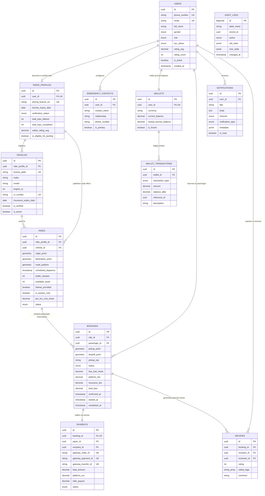

# Database Architecture & Design Document
# Platform: TwoShare (Intra-City Urban Bike Pooling Platform)
**Version:** 1.0.0  
**Architect:** Database Architect  
**Target Engine:** PostgreSQL 16+ with PostGIS 3.4 Spatial Extensions  
**DDL Script Reference:** [`database_schema.sql`](file:///d:/Urban%20Bike%20Pooling%20Platform/database_schema.sql)

---

## 1. Entity Relationship (ER) Diagram



---

## 2. Normalized Schema Architecture (3NF & Domain Boundaries)

The schema complies with **Third Normal Form (3NF)** while respecting geospatial processing realities and transactional ACID semantics:

### 2.1 First Normal Form (1NF) Compliance
* All attributes are atomic. Geospatial objects (`Point`, `LineString`) are native spatial types provided by PostGIS conforming to the OpenGIS Simple Features Specification.
* Repeating groups are normalized into separate tables (e.g., `emergency_contacts`, `wallet_transactions`, `vehicles`).

### 2.2 Second Normal Form (2NF) Compliance
* All tables have single-column primary keys (`UUID` generated via `uuid_generate_v4()` for distributed safety, except `audit_logs` which uses an append-only `BIGSERIAL`).
* Non-key columns depend wholly on the entire primary key, eliminating partial dependencies.

### 2.3 Third Normal Form (3NF) Compliance
* **Separation of Commuter Identity from Rider Attributes:** While all participants are in `users`, driving credentials, license documents, and transport verification details exist strictly in `rider_profiles`. This prevents null bloat for pure passenger accounts.
* **Separation of Ride Offering from Reservation:** A ride offer (`rides`) represents the scheduled route trajectory published by a rider. Reservations (`bookings`) represent the binding agreement between a passenger and that ride.
* **Double-Entry Wallet Ledger:** `wallets` maintains current state, while `wallet_transactions` maintains an immutable append-only ledger of every debit, credit, and escrow hold.

---

## 3. Data Dictionary & Detailed Entity Specifications

| Table | Entity Purpose | Key Integrity Constraints | Primary Spatial Data |
| :--- | :--- | :--- | :--- |
| `users` | Base identity for all platform actors. | `phone_number` E.164 format check, unique email/phone. | None |
| `rider_profiles` | Verifiable transport credentials for bike hosts. | License expiry must be in the future, unique DL number. | None |
| `vehicles` | Two-wheeler motorcycle/scooter assets. | Engine CC between 50 and 1200, valid insurance, unique plate. | None |
| `emergency_contacts` | Distress escalation contacts for riders/passengers. | Max 1 primary contact per user, valid phone format. | None |
| `wallets` | In-app commuter balance and escrow holding. | Non-negative balance, currency default INR. | None |
| `wallet_transactions` | Immutable audit ledger for wallet mutations. | `amount != 0`, `balance_after >= 0`, verified by trigger. | None |
| `rides` | Scheduled corridor polyline offers by bike owners. | `available_seats` $\in \{0, 1\}$, `per_km_cost_share > 0`. | `route_polyline` (LineString), `origin_point`, `destination_point` |
| `bookings` | Passenger seat requests and ride state machine. | 4-digit numeric OTP, formula check on total fare. | `pickup_point` (Point), `dropoff_point` (Point) |
| `payments` | Razorpay payment orders, escrow, and route splits. | `total_amount = platform_cut + rider_payout + insurance`. | None |
| `reviews` | Mutual 1-5 star ratings and safety endorsements. | `reviewer_id != reviewee_id`, unique per booking per user. | None |
| `notifications` | In-app, push, SMS, and WhatsApp alerts. | Unread index for instant client inbox query. | None |
| `audit_logs` | Change Data Capture (CDC) table for security audit. | Append-only, captures JSON delta of OLD and NEW rows. | None |

---

## 4. Indexing Strategy & Performance Tuning

```
+-------------------------------------------------------------------------------------------------------+
|                                    DATABASE INDEXING MATRIX                                           |
+-----------------------------------+-----------------------------------+-------------------------------+
| Spatial (GiST):                   | High-Selectivity Partial B-Tree:  | Covering & Composite B-Tree:  |
| • rides(route_polyline)           | • rides(scheduled, status='SCHED')| • users(role, is_active)      |
| • rides(origin_point, dest_point) | • bookings(active passenger rides)| • wallet_txns(wallet_id, date)|
| • bookings(pickup, dropoff)       | • notifications(user_id, unread)  | • payments(order_id, status)  |
+-----------------------------------+-----------------------------------+-------------------------------+
```

1. **GiST Spatial Indexes (`idx_rides_route_spatial`, `idx_rides_origin_spatial`, `idx_rides_dest_spatial`):**  
   R-Tree indexes over PostGIS geometry types enable sub-millisecond bounding box (`&&`) and distance (`ST_DWithin`) queries, supporting rapid corridor intersection checks across millions of routes.
2. **Partial Indexes:**  
   * `idx_rides_active_sched`: Filters strictly on `WHERE status = 'SCHEDULED'`. Disregards millions of historical completed rides during real-time matching.
   * `idx_notifications_user_unread`: Filters on `WHERE is_read = FALSE` to accelerate user badge counts.
   * `idx_bookings_active_pass`: Accelerates active trip queries on the mobile client.
3. **Composite B-Tree Indexes:**  
   * `idx_wallet_txns_wallet_date`: Optimizes chronologically sorted wallet transaction statements (`ORDER BY created_at DESC`).
   * `idx_emergency_contacts_primary`: Fast lookup for SOS dispatch logic.

---

## 5. Constraints & Data Integrity Guardrails

1. **Phone Number Integrity:** Enforced via POSIX regular expression: `CHECK (phone_number ~ '^\+[1-9]\d{1,14}$')`.
2. **Pickup OTP Integrity:** Enforced 4-digit PIN: `CHECK (pickup_otp ~ '^\d{4}$')`.
3. **Pillion Capacity Hard-Limit:** `available_seats IN (0, 1)` strictly blocks triple-riding.
4. **Financial Consistency:** `CHECK (total_amount = platform_cut + rider_payout + insurance_premium)` guarantees zero leakage between captured funds and distributed payouts.
5. **Self-Review Prevention:** `CHECK (reviewer_id <> reviewee_id)` prevents users from rating themselves.
6. **Date Validations:** `check_license_expiry` and `check_insurance_validity` disallow registering expired documentation.

---

## 6. Triggers & Automated Business Logic

The schema deploys five production PL/pgSQL triggers to automate core business workflows:

### 6.1 `trg_users_updated_at` (Auto-Touch Timestamp)
Automatically updates `updated_at = CURRENT_TIMESTAMP` before any `UPDATE` on mutable tables.

### 6.2 `trg_recompute_rating_on_review` (Atomic Rating Averaging)
When a review is submitted:
1. Calculates the new arithmetic mean (`AVG(rating)`) and count (`COUNT(id)`) for the `reviewee_id`.
2. Updates `users.rating_avg` and `users.rating_count`.
3. If the user has a `rider_profiles` row, synchronizes `rider_profiles.safety_rating_avg`.

### 6.3 `trg_manage_ride_seats` (Atomic Seat Allocation)
* When a booking transitions to `status = 'CONFIRMED'`, decrements `rides.available_seats` to `0`.
* If a confirmed booking is subsequently `CANCELLED` or `REJECTED`, increments `rides.available_seats` back to `1`, instantly restoring route liquidity in search results.

### 6.4 `trg_wallet_balance_guard` (Ledger Consistency Enforcement)
Before inserting into `wallet_transactions`:
1. Validates that `balance_after` precisely equals `current_balance + amount`.
2. Atomically updates `wallets.current_balance = NEW.balance_after`, eliminating race conditions between concurrent debits/credits.

### 6.5 `trg_audit_*` (CDC / Audit Logging)
Intercepts `INSERT`, `UPDATE`, and `DELETE` on sensitive tables (`bookings`, `payments`, `wallets`, `rides`), storing the complete `OLD` and `NEW` row states as JSONB objects in `audit_logs` with microsecond timestamps.

---

## 7. Change Data Capture & Audit Log Architecture

The `audit_logs` table provides tamper-evident tracking for disputes, fraud investigations, and financial compliance:

```sql
-- Sample output from audit_logs table during a ride state transition
SELECT 
    table_name, 
    action, 
    record_id, 
    old_state->>'status' AS prev_status, 
    new_state->>'status' AS updated_status, 
    changed_at
FROM audit_logs
WHERE table_name = 'bookings'
ORDER BY changed_at DESC
LIMIT 5;
```

```
 table_name | action |              record_id               | prev_status | updated_status |          changed_at          
------------+--------+--------------------------------------+-------------+----------------+------------------------------
 bookings   | UPDATE | e4b2d184-789a-4c28-98e1-5837190ef91a | CONFIRMED   | STARTED        | 2026-09-08 08:35:12.1023+00
 bookings   | UPDATE | e4b2d184-789a-4c28-98e1-5837190ef91a | REQUESTED   | CONFIRMED      | 2026-09-08 08:31:04.9124+00
 bookings   | INSERT | e4b2d184-789a-4c28-98e1-5837190ef91a |             | REQUESTED      | 2026-09-08 08:30:19.4412+00
```
