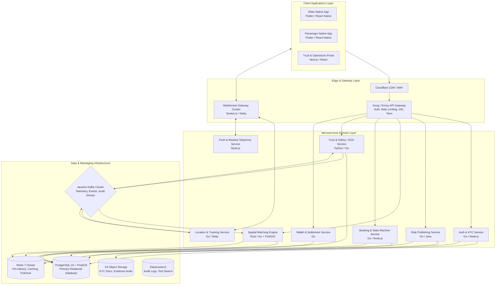
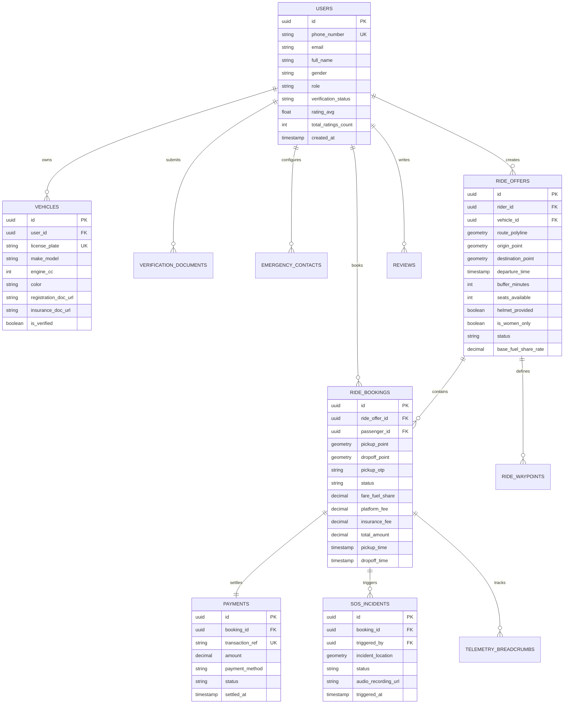
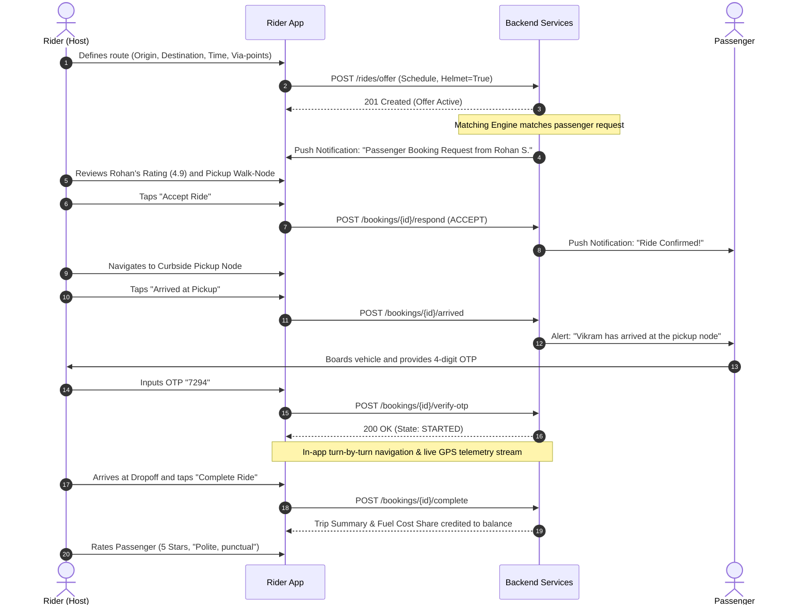
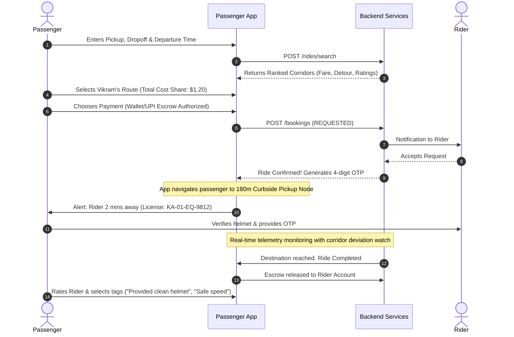
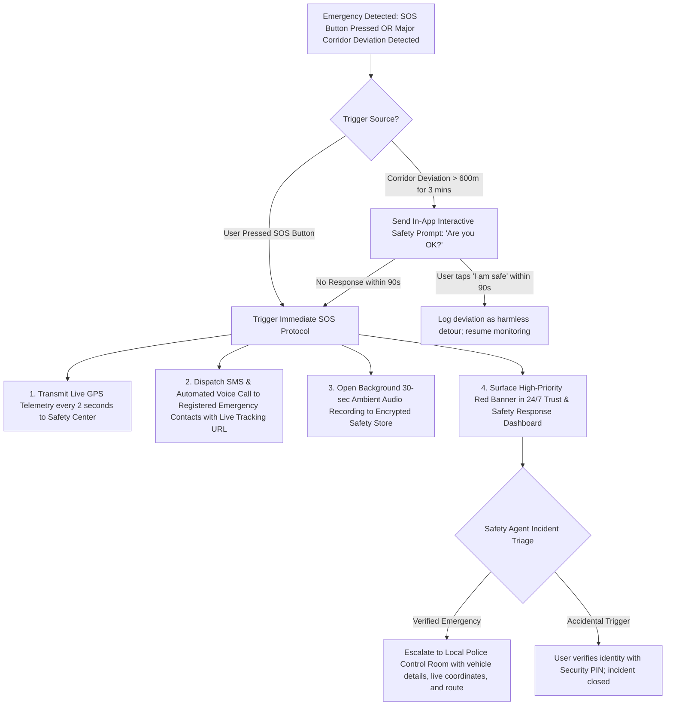
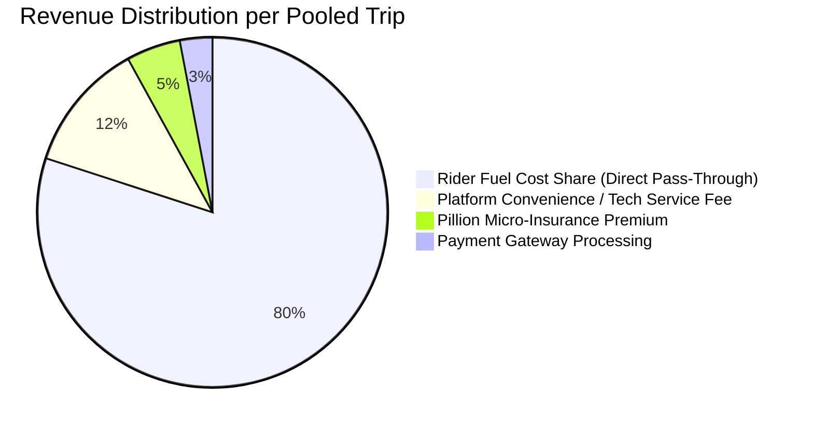

# Product Requirements Document (PRD)
# Platform Name (Working Title): TwoShare (Urban Pillion Ride-Pooling)
**Version:** 1.0.0-PROD  
**Author:** Senior Product Manager (Urban Mobility)  
**Status:** Approved for Architecture Review & Engineering Sprint 0  
**Target Launch:** Q3 2026 (Beta / MVP in Tier-1 Metro Corridor)  

---

## Executive Summary
Rapid urbanization and vehicle density in metropolitan hubs have led to severe traffic congestion, prolonged commute times, and elevated carbon emissions. Millions of two-wheeler commuters commute daily with an unoccupied pillion seat, while adjacent public transit systems (buses, metro lines) face extreme peak-hour overcrowding, and on-demand cab/auto aggregators suffer from surge pricing and low supply availability.

**TwoShare** is an intra-city, non-commercial, peer-to-peer bike pooling platform designed to connect motorcycle/scooter owners with daily commuters traveling along intersecting urban transit corridors. By digitizing route-matching, cost-sharing, and identity verification, TwoShare delivers an affordable, fast, and eco-friendly urban mobility solution while strictly operating within cost-sharing legal frameworks.

---

## 1. Vision, Mission & Strategic Alignment

### 1.1 Vision
To transform every empty pillion seat in urban transit into a shared, sustainable, and reliable commute asset, reducing city vehicular emissions and road congestion by 30% over the next decade.

### 1.2 Mission
To provide urban commuters with the fastest, safest, and most cost-effective daily travel option by connecting verified bike owners and co-travelers through real-time corridor matching and automated micro-cost sharing.

### 1.3 Strategic Value Proposition
* **For the Bike Rider (Host):** Offset escalating daily fuel and vehicle maintenance expenses without deviating significantly from their regular commute route or acting as a full-time commercial driver.
* **For the Passenger (Co-Rider):** Cut daily commute expenses by 50–70% compared to ride-hailing cabs/autos, achieve 2x faster travel times than buses through congested corridors, and avoid dynamic surge pricing.
* **For the City & Environment:** Mitigate vehicular congestion, optimize roadway passenger throughput per square meter, and curtail carbon emissions per passenger-kilometer traveled.

### 1.4 North Star & Key Business Metrics
* **North Star Metric:** Completed Pooled Seat Kilometers (CPSK) per week.
* **Primary Conversion Metric:** Match-to-Booking Fulfillment Rate ($\ge 65\%$ during peak hours: 08:00–10:30 & 17:30–20:30).
* **Unit Economics Metric:** Average Cost Offset per Rider per Trip vs Platform Service Take-Rate.
* **Trust & Safety Metric:** Zero Unverified Trip Rate ($100\%$ verified identities), Critical Incident Rate $< 0.001\%$.
* **Retention Metric:** D30 Commuter Retention ($\ge 42\%$ recurring weekday commuters).

---

## 2. Target Market & User Personas

### 2.1 Persona Matrix

| Attribute | Persona 1: Commuter Host (Rider) | Persona 2: Daily Cost-Conscious Passenger | Persona 3: Safety-First Female Commuter |
| :--- | :--- | :--- | :--- |
| **Archetype** | "Vikram, The Solo Tech Commuter" | "Rohan, The Junior Analyst" | "Ananya, The Safety-Conscious Professional" |
| **Demographics** | 27, Male, Software Engineer, commutes 18 km each way daily on a 150cc motorcycle. | 23, Male, Graduate Trainee, monthly budget constrained, no personal vehicle. | 25, Female, UX Designer, commutes across commercial corridor, hyper-aware of personal safety. |
| **Pain Points** | • High monthly fuel expenditure (~$50–$70/mo)<br>• Monotonous solitary daily commute<br>• Does not want to work as a commercial cab driver. | • Cabs surge 2.5x during rain/peak hours<br>• City buses are suffocatingly packed and slow<br>• Metro stations require expensive first/last-mile autos. | • Reluctant to ride pillion with unverified strangers<br>• Hygiene and helmet availability concerns<br>• Requires guaranteed live tracking and distress triggers. |
| **Primary Goals** | Recover 60–80% of monthly fuel costs with minimal detour ($< 5\text{ mins}$). | Reliable, fixed-cost, point-to-point daily commute under 35 minutes. | Safe, verified, comfortable commute with female rider preference and zero harassment tolerance. |
| **Tech Savviness** | High (Android/iOS, UPI payments, Google Maps navigation). | High (Mobile-first, price comparison apps, public transit apps). | High (Prefers privacy toggles, OTP verifications, emergency contact relays). |

---

## 3. User Stories & Acceptance Criteria

### Epic 1: Trust, Verification & Onboarding
* **US-1.1 (Govt ID & Driving License Verification):**  
  *As a platform administrator and passenger, I want riders to verify their driving license, national identity (e.g., Aadhaar/Govt ID via DigiLocker), and vehicle registration certificate (RC) before publishing rides, so that uncertified or illegal vehicles are barred from the network.*  
  * **Acceptance Criteria:**
    * Rider document uploads must be validated via automated OCR + Government Verification API within 90 seconds.
    * System triggers automated face-matching (liveness selfie vs. ID photo) with a confidence threshold $\ge 92\%$.
    * Pillion ride publishing is hard-disabled until `verification_status == 'VERIFIED'`.

* **US-1.2 (Passenger Profile Verification):**  
  *As a rider, I want passengers to have verified phone numbers, corporate email/Govt IDs, and real-name profiles so that I know who is boarding my personal vehicle.*  
  * **Acceptance Criteria:**
    * Mandatory phone OTP verification + optional corporate email verification for "Workplace Verified" badge.
    * Emergency contact (minimum 1) required before booking first ride.

### Epic 2: Ride Offering & Route Scheduling (Rider)
* **US-2.1 (Recurring & Instant Ride Publishing):**  
  *As a rider, I want to publish my daily morning and evening route (origin, destination, departure time window, detour tolerance, and spare helmet availability) once as a recurring schedule, so that I don't have to manually create rides every single day.*  
  * **Acceptance Criteria:**
    * Rider can select recurring days (e.g., Mon–Fri) and set departure time buffer ($\pm 5, 10, 15\text{ mins}$).
    * Rider must toggle `helmet_provided_for_pillion: true/false`.
    * Route polyline is generated via OpenStreetMap/Mapbox/Google Directions API and stored in PostGIS.

### Epic 3: Ride Discovery & Spatial Route Matching (Passenger)
* **US-3.1 (Corridor Overlap Search):**  
  *As a passenger, I want to input my pickup and drop-off points and desired departure time, and discover riders whose pre-existing travel path overlaps with mine, so that I can book a ride that minimizes detours.*  
  * **Acceptance Criteria:**
    * System evaluates candidate routes where:
      1. Passenger pickup point is within $R_{\text{walk}} \le 400\text{ meters}$ of rider’s route polyline.
      2. Passenger dropoff point is within $R_{\text{drop}} \le 400\text{ meters}$ of rider’s route polyline.
      3. Total rider detour time $\le 10\text{ minutes}$.
      4. Estimated pickup time matches within passenger’s time buffer window.
    * Results are ranked by detour time, rider safety rating, and pricing.

### Epic 4: Booking, Mutual Agreement & Execution
* **US-4.1 (Request and Auto-Accept):**  
  *As a passenger, I want to request a seat or instantly book if the rider has enabled Instant Match, so that I get timely confirmation.*  
  * **Acceptance Criteria:**
    * Standard Request: Rider receives actionable push notification with passenger rating, mutual contacts/workplace, and pickup walk-point; rider has 180 seconds to accept before request expires.
    * Auto-Accept: Instant booking allowed only if passenger has $\ge 4.5$ star rating and verified profile.

* **US-4.2 (Start of Ride OTP Verification):**  
  *As a rider and passenger, we want a secure 4-digit PIN exchange before the trip begins, so that ride start is verified and erroneous passenger boarding is prevented.*  
  * **Acceptance Criteria:**
    * Passenger app displays a dynamic 4-digit OTP.
    * Rider must input this OTP into rider app. Trip state cannot transition to `STARTED` without valid OTP match.
    * System records timestamp and exact GPS coordinate of pickup.

### Epic 5: Live Tracking, Safety & SOS
* **US-5.1 (Real-Time Live Telemetry & Safe Corridor Monitoring):**  
  *As a passenger and rider, I want real-time location sharing during the trip, with automatic deviation alerts if the bike departs from the expected corridor.*  
  * **Acceptance Criteria:**
    * Rider device streams GPS telemetry every 3 seconds via WebSocket.
    * If vehicle deviates $> 600\text{ meters}$ from planned corridor for $> 3\text{ minutes}$, an automated in-app prompt checks on rider/passenger safety ("Are you safe?").
    * Unresponsive state ($> 90\text{ seconds}$) escalates to Platform Safety Desk and SMS to emergency contacts.

* **US-5.2 (Emergency SOS Dispatch):**  
  *As a user in distress, I want a single-tap SOS button that instantly notifies emergency contacts, the platform safety team, and local police with live tracking coordinates.*  
  * **Acceptance Criteria:**
    * Triggering SOS initiates silent alert, records 30-second ambient audio clip, and transmits location broadcast every 2 seconds.

### Epic 6: Fare Calculation & Legal Cost Recovery
* **US-6.1 (Statutory Cost-Sharing Fare Calculation):**  
  *As a platform operator, I want fares to be calculated strictly on an operational cost-sharing formula (fuel consumption + vehicle depreciation basis) so that the service complies with non-commercial carpooling legislation.*  
  * **Acceptance Criteria:**
    * Maximum allowable passenger share per km is capped by system formula:  
      $$\text{Max Fare} = \frac{\text{Distance} \times (\text{Average Fuel Consumption per km} \times \text{Fuel Price} + \text{Wear Allowance})}{\text{Occupants (2)}}$$
    * Riders are strictly forbidden from inflating fares beyond statutory cost-sharing caps.

---

## 4. Functional Requirements

### 4.1 Rider Module
* **FR-R01 (Profile & Onboarding):** Mandatory input of full name, phone number, emergency contacts, profile photo, and emergency blood group.
* **FR-R02 (Vehicle Management):** Input make, model, year, registration number (license plate), vehicle photo, and insurance policy expiration.
* **FR-R03 (Ride Creation Engine):**
  * Origin and destination selection with interactive map pin-drop or address autocomplete.
  * Intermediate waypoint configuration (up to 3 via-points).
  * Departure time and buffer window ($\pm 5, \pm 10, \pm 15$ mins).
  * Recurrence configuration (days of week, effective date range).
  * Seat availability (hard-capped at 1 pillion seat).
  * Spare helmet availability declaration.
  * Female-only pool toggle (visible only to verified female riders).
* **FR-R04 (Booking Management):** Accept/Decline pending passenger booking requests with counter-offer for pickup spot or time.
* **FR-R05 (Trip Execution):** Navigation integration (in-app Google Maps/Mapbox turn-by-turn navigation), OTP verification, trip pause/resume, and trip completion trigger.

### 4.2 Passenger Module
* **FR-P01 (Ride Search Engine):** Query with pickup location, dropoff location, date, and preferred departure time window.
* **FR-P02 (Corridor Visualization):** Map interface displaying rider’s proposed polyline, passenger’s suggested pickup walking point (curbside node), and dropoff walking point.
* **FR-P03 (Booking Checkout):** Transparent fare breakdown (fuel cost share + platform tech fee + micro-insurance fee), payment method selection (UPI, Credit/Debit Card, In-app Commute Wallet).
* **FR-P04 (Active Trip Screen):** Real-time rider approach tracking with dynamic ETA, vehicle registration display, rider photo, and one-time masked call/chat.

### 4.3 Matching & Geo-Routing Engine
* **FR-M01 (Polyline Buffer Spatial Search):** Convert rider route into spatial linestring with a dynamic spatial buffer ($400\text{m}$ radius in dense urban areas, $800\text{m}$ in suburban corridors).
* **FR-M02 (Detour Cost Optimization):** Reject rider-passenger pairs where total detour time exceeds 10 minutes or adds $> 20\%$ to rider's original travel distance.
* **FR-M03 (Pickup Node Clustering):** Direct passengers to designated public curbside pick-up points (e.g., bus stops, metro station exits, commercial building gates) to eliminate dangerous mid-road stops.

### 4.4 Communication & Privacy Engine
* **FR-C01 (Number Masking):** All voice communication routed through Virtual Telephony Proxy (e.g., Twilio/Exotel). Real telephone numbers are never exposed.
* **FR-C02 (In-App Ephemeral Chat):** End-to-end encrypted messaging active only from booking confirmation until 15 minutes post-trip completion.

### 4.5 Trust, Safety & Women-Only Mode ("ShePool")
* **FR-S01 (ShePool Filtering):** Verified female riders can restrict their offers to female passengers only; verified female passengers can search exclusively for female-operated rides.
* **FR-S02 (Helmet Compliance Photo Verification):** At pickup, the app requests an optional selfie check verifying both rider and passenger are wearing ISI/DOT-certified helmets.
* **FR-S03 (Dual-Blind Rating System):** 1-to-5 star rating and safety tags (e.g., "Smooth Rider", "Safe Speed", "Punctual", "Rude Behavior", "Rash Driving") revealed only after both parties submit reviews.

---

## 5. Non-Functional Requirements (NFRs)

```
+------------------------------------------------------------------------------------+
|                         NON-FUNCTIONAL REQUIREMENT TARGETS                         |
+--------------------------+----------------------------+----------------------------+
| Search P99 Latency:      | Real-time Telemetry Lag:   | Platform Availability SLA: |
| < 450 ms                 | < 1.2 seconds              | 99.95% Uptime              |
+--------------------------+----------------------------+----------------------------+
| Peak Concurrent Users:   | Spatial Index Resolution:  | Battery Drain Target:      |
| 150,000 Concurrent       | Uber H3 Resolution 8-9     | < 4% per hour GPS tracking |
+--------------------------+----------------------------+----------------------------+
```

### 5.1 Performance & Latency
* **NFR-P01:** Ride search and corridor matching queries must return top 20 matched routes within $P95 < 300\text{ ms}$ and $P99 < 500\text{ ms}$ under peak loads of 15,000 queries per minute.
* **NFR-P02:** High-frequency GPS telemetry ingestion pipeline must support $> 50,000\text{ updates/sec}$ with end-to-end propagation latency to the tracking client of $< 1.2\text{ seconds}$.

### 5.2 Scalability & Concurrency
* **NFR-S01:** System architecture must auto-scale horizontally to accommodate a 5x surge in search/booking volume during peak morning (08:00–10:30) and evening (17:30–20:30) commute spikes.
* **NFR-S02:** Ephemeral chat and live telemetry must leverage distributed WebSocket connections managed via Redis Pub/Sub cluster or managed broker.

### 5.3 Security, Privacy & Data Protection
* **NFR-SEC01 (Data Encryption):** All transit communications enforced via TLS 1.3. Sensitive data at rest (passwords, identity documents, bank account/UPI IDs) encrypted using AES-256-GCM.
* **NFR-SEC02 (PII Minimization):** Government identity document raw images stored in secure, private S3/GCS buckets with presigned time-limited access URLs. Raw national ID numbers are hashed/tokenized.
* **NFR-SEC03 (OWASP Compliance):** Zero critical vulnerabilities across OWASP API Security Top 10. Rate limiting enforced on authentication and search endpoints (e.g., maximum 30 OTP requests per IP/device per hour).

### 5.4 Reliability & Fault Tolerance
* **NFR-R01:** High Availability target of $99.95\%$ uptime across API Gateway, Booking Engine, and Safety Services (excluding scheduled maintenance windows).
* **NFR-R02:** Offline-resilient client caching for active rides: In case of transient cellular dead zones, the mobile client must queue telemetry checkpoints locally and flush them upon network reconnection without data loss.

---

## 6. System Architecture

### 6.1 Architectural Topology
The platform employs a cloud-native, microservices-based architecture built around event-driven domain boundaries, containerized with Kubernetes (EKS/GKE), and backed by managed geo-spatial relational stores and low-latency cache clusters.



### 6.2 Key Subsystem Responsibilities
1. **Spatial Matching Engine:** Computes bounding boxes and polyline intersection algorithms using PostGIS `ST_DWithin`, `ST_Distance`, and Uber H3 hexagonal discrete global grid indexing for sub-second candidate lookup.
2. **Telemetry Service:** Ingests live rider GPS breadcrumbs over persistent WebSockets, calculates instantaneous speed and heading, publishes to Kafka topic `vehicle-telemetry`, and updates Redis Geo sets for live passenger tracking.
3. **Safety & Anomaly Detection Engine:** Consumes live telemetry from Kafka; monitors spatial deviation thresholds against the expected route, prolonged abnormal stoppages, and sudden deceleration (potential collision) events.
4. **Booking & State Transition Service:** Implements an atomic state machine guaranteeing ACID compliance over trip state transitions (`OFFERED` $\to$ `REQUESTED` $\to$ `CONFIRMED` $\to$ `ARRIVED` $\to$ `STARTED` $\to$ `COMPLETED`).

---

## 7. Database Design & Data Models

### 7.1 Entity Relationship Diagram



### 7.2 Database Schemas (DDL - PostgreSQL 16 + PostGIS)

```sql
-- Enable PostGIS and UUID extensions
CREATE EXTENSION IF NOT EXISTS "uuid-ossp";
CREATE EXTENSION IF NOT EXISTS "postgis";

-- 1. Users Table
CREATE TABLE users (
    id UUID PRIMARY KEY DEFAULT uuid_generate_v4(),
    phone_number VARCHAR(20) UNIQUE NOT NULL,
    email VARCHAR(100) UNIQUE,
    full_name VARCHAR(100) NOT NULL,
    gender VARCHAR(20) NOT NULL CHECK (gender IN ('FEMALE', 'MALE', 'NON_BINARY', 'PREFER_NOT_TO_SAY')),
    profile_photo_url TEXT,
    verification_status VARCHAR(30) DEFAULT 'PENDING' CHECK (verification_status IN ('PENDING', 'IN_REVIEW', 'VERIFIED', 'REJECTED', 'SUSPENDED')),
    bio TEXT,
    rating_avg NUMERIC(3, 2) DEFAULT 5.00,
    total_ratings_count INT DEFAULT 0,
    is_active BOOLEAN DEFAULT TRUE,
    created_at TIMESTAMPTZ DEFAULT CURRENT_TIMESTAMP,
    updated_at TIMESTAMPTZ DEFAULT CURRENT_TIMESTAMP
);
CREATE INDEX idx_users_phone ON users(phone_number);
CREATE INDEX idx_users_verification ON users(verification_status);

-- 2. Vehicles Table
CREATE TABLE vehicles (
    id UUID PRIMARY KEY DEFAULT uuid_generate_v4(),
    user_id UUID NOT NULL REFERENCES users(id) ON DELETE CASCADE,
    license_plate VARCHAR(30) UNIQUE NOT NULL,
    make_model VARCHAR(80) NOT NULL,
    engine_cc INT NOT NULL,
    color VARCHAR(30) NOT NULL,
    rc_number VARCHAR(50) NOT NULL,
    rc_doc_url TEXT,
    insurance_policy_no VARCHAR(60),
    insurance_expiry_date DATE,
    is_verified BOOLEAN DEFAULT FALSE,
    created_at TIMESTAMPTZ DEFAULT CURRENT_TIMESTAMP
);
CREATE INDEX idx_vehicles_user ON vehicles(user_id);
CREATE INDEX idx_vehicles_plate ON vehicles(license_plate);

-- 3. Verification Documents Table
CREATE TABLE verification_documents (
    id UUID PRIMARY KEY DEFAULT uuid_generate_v4(),
    user_id UUID NOT NULL REFERENCES users(id) ON DELETE CASCADE,
    doc_type VARCHAR(30) NOT NULL CHECK (doc_type IN ('DRIVING_LICENSE', 'NATIONAL_ID', 'CORP_EMAIL', 'SELFIE_LIVENESS')),
    doc_identifier VARCHAR(100),
    document_front_url TEXT NOT NULL,
    document_back_url TEXT,
    ocr_extracted_data JSONB,
    verification_response JSONB,
    status VARCHAR(30) DEFAULT 'SUBMITTED' CHECK (status IN ('SUBMITTED', 'VERIFIED', 'FAILED')),
    verified_at TIMESTAMPTZ,
    created_at TIMESTAMPTZ DEFAULT CURRENT_TIMESTAMP
);
CREATE INDEX idx_verif_user_type ON verification_documents(user_id, doc_type);

-- 4. Emergency Contacts Table
CREATE TABLE emergency_contacts (
    id UUID PRIMARY KEY DEFAULT uuid_generate_v4(),
    user_id UUID NOT NULL REFERENCES users(id) ON DELETE CASCADE,
    contact_name VARCHAR(100) NOT NULL,
    relationship VARCHAR(40),
    contact_phone VARCHAR(20) NOT NULL,
    is_primary BOOLEAN DEFAULT FALSE,
    created_at TIMESTAMPTZ DEFAULT CURRENT_TIMESTAMP
);
CREATE INDEX idx_emergency_user ON emergency_contacts(user_id);

-- 5. Ride Offers Table (Created by Rider)
CREATE TABLE ride_offers (
    id UUID PRIMARY KEY DEFAULT uuid_generate_v4(),
    rider_id UUID NOT NULL REFERENCES users(id),
    vehicle_id UUID NOT NULL REFERENCES vehicles(id),
    origin_point GEOMETRY(Point, 4326) NOT NULL,
    destination_point GEOMETRY(Point, 4326) NOT NULL,
    origin_address TEXT NOT NULL,
    destination_address TEXT NOT NULL,
    route_polyline GEOMETRY(LineString, 4326) NOT NULL,
    departure_time TIMESTAMPTZ NOT NULL,
    buffer_minutes INT DEFAULT 10,
    seats_available INT DEFAULT 1 CHECK (seats_available IN (0, 1)),
    helmet_provided BOOLEAN DEFAULT TRUE,
    is_women_only BOOLEAN DEFAULT FALSE,
    per_km_cost_share NUMERIC(6, 2) NOT NULL,
    status VARCHAR(30) DEFAULT 'SCHEDULED' CHECK (status IN ('SCHEDULED', 'ACTIVE', 'COMPLETED', 'CANCELLED')),
    recurring_rule VARCHAR(100), -- e.g. "FREQ=WEEKLY;BYDAY=MO,TU,WE,TH,FR"
    created_at TIMESTAMPTZ DEFAULT CURRENT_TIMESTAMP
);
CREATE INDEX idx_ride_offers_spatial_route ON ride_offers USING GIST(route_polyline);
CREATE INDEX idx_ride_offers_departure ON ride_offers(departure_time);
CREATE INDEX idx_ride_offers_status ON ride_offers(status);

-- 6. Ride Bookings Table (Reserved by Passenger)
CREATE TABLE ride_bookings (
    id UUID PRIMARY KEY DEFAULT uuid_generate_v4(),
    ride_offer_id UUID NOT NULL REFERENCES ride_offers(id),
    passenger_id UUID NOT NULL REFERENCES users(id),
    pickup_point GEOMETRY(Point, 4326) NOT NULL,
    dropoff_point GEOMETRY(Point, 4326) NOT NULL,
    pickup_address TEXT NOT NULL,
    dropoff_address TEXT NOT NULL,
    pickup_otp VARCHAR(4) NOT NULL,
    distance_meters INT NOT NULL,
    fare_fuel_share NUMERIC(8, 2) NOT NULL,
    platform_fee NUMERIC(8, 2) NOT NULL,
    insurance_fee NUMERIC(8, 2) NOT NULL,
    total_amount NUMERIC(8, 2) NOT NULL,
    status VARCHAR(30) DEFAULT 'REQUESTED' CHECK (status IN ('REQUESTED', 'CONFIRMED', 'ARRIVED', 'STARTED', 'COMPLETED', 'CANCELLED', 'REJECTED')),
    started_at TIMESTAMPTZ,
    completed_at TIMESTAMPTZ,
    cancellation_reason TEXT,
    created_at TIMESTAMPTZ DEFAULT CURRENT_TIMESTAMP
);
CREATE INDEX idx_bookings_offer ON ride_bookings(ride_offer_id);
CREATE INDEX idx_bookings_passenger ON ride_bookings(passenger_id);
CREATE INDEX idx_bookings_status ON ride_bookings(status);

-- 7. Telemetry Breadcrumbs (Live location tracking audit)
CREATE TABLE telemetry_breadcrumbs (
    id BIGSERIAL PRIMARY KEY,
    booking_id UUID NOT NULL REFERENCES ride_bookings(id),
    current_location GEOMETRY(Point, 4326) NOT NULL,
    speed_kmh NUMERIC(5, 2),
    bearing NUMERIC(5, 2),
    recorded_at TIMESTAMPTZ NOT NULL
);
CREATE INDEX idx_telemetry_booking_time ON telemetry_breadcrumbs(booking_id, recorded_at DESC);

-- 8. Payments & Settlement Table
CREATE TABLE payments (
    id UUID PRIMARY KEY DEFAULT uuid_generate_v4(),
    booking_id UUID NOT NULL REFERENCES ride_bookings(id) UNIQUE,
    payer_id UUID NOT NULL REFERENCES users(id),
    recipient_id UUID NOT NULL REFERENCES users(id),
    amount NUMERIC(8, 2) NOT NULL,
    platform_commission NUMERIC(8, 2) NOT NULL,
    rider_payout_amount NUMERIC(8, 2) NOT NULL,
    gateway_transaction_id VARCHAR(100) UNIQUE,
    payment_method VARCHAR(40) CHECK (payment_method IN ('UPI', 'CREDIT_CARD', 'DEBIT_CARD', 'COMMUTE_WALLET')),
    status VARCHAR(30) DEFAULT 'INITIATED' CHECK (status IN ('INITIATED', 'AUTHORIZED', 'SETTLED', 'REFUNDED', 'FAILED')),
    settled_at TIMESTAMPTZ,
    created_at TIMESTAMPTZ DEFAULT CURRENT_TIMESTAMP
);
CREATE INDEX idx_payments_status ON payments(status);

-- 9. Reviews & Ratings Table
CREATE TABLE reviews (
    id UUID PRIMARY KEY DEFAULT uuid_generate_v4(),
    booking_id UUID NOT NULL REFERENCES ride_bookings(id),
    author_id UUID NOT NULL REFERENCES users(id),
    target_user_id UUID NOT NULL REFERENCES users(id),
    rating INT NOT NULL CHECK (rating BETWEEN 1 AND 5),
    safety_tags TEXT[], -- array e.g. {'SAFE_DRIVER', 'HELMET_PROVIDED'}
    review_comment TEXT,
    created_at TIMESTAMPTZ DEFAULT CURRENT_TIMESTAMP,
    CONSTRAINT unique_booking_author UNIQUE(booking_id, author_id)
);

-- 10. SOS Incidents Table
CREATE TABLE sos_incidents (
    id UUID PRIMARY KEY DEFAULT uuid_generate_v4(),
    booking_id UUID NOT NULL REFERENCES ride_bookings(id),
    triggered_by UUID NOT NULL REFERENCES users(id),
    incident_location GEOMETRY(Point, 4326) NOT NULL,
    status VARCHAR(30) DEFAULT 'ACTIVE' CHECK (status IN ('ACTIVE', 'DISPATCHED', 'RESOLVED', 'FALSE_ALARM')),
    audio_recording_url TEXT,
    resolution_notes TEXT,
    triggered_at TIMESTAMPTZ DEFAULT CURRENT_TIMESTAMP,
    resolved_at TIMESTAMPTZ
);
CREATE INDEX idx_sos_status ON sos_incidents(status);
```

---

## 8. API Specifications (RESTful & WebSocket)

### 8.1 API Conventions
* **Base URL:** `https://api.twoshare.io/api/v1`
* **Authentication:** Bearer JWT in `Authorization` header.
* **Content Type:** `application/json`

---

### 8.2 Endpoints Directory

#### 1. Authentication & KYC
* `POST /auth/phone/send-otp`  
  *Request:* `{ "phone_number": "+919876543210" }`  
  *Response:* `200 OK` `{ "session_id": "sess_89f412", "expires_in": 120 }`

* `POST /auth/phone/verify-otp`  
  *Request:* `{ "session_id": "sess_89f412", "otp": "4591" }`  
  *Response:* `200 OK` `{ "access_token": "eyJhb...", "user_id": "u_98d3a1", "is_new_user": false }`

* `POST /kyc/verify-document`  
  *Request Multipart Form:* `doc_type=DRIVING_LICENSE`, `doc_front=<binary>`, `selfie_image=<binary>`  
  *Response:* `202 Accepted` `{ "kyc_tracking_id": "kyc_441a", "status": "IN_PROGRESS" }`

---

#### 2. Ride Publishing (Rider)
* `POST /rides/offer`
  *Description:* Creates a single or recurring ride offer along a specified trajectory.
  *Request Body:*
  ```json
  {
    "vehicle_id": "veh_3812fa",
    "origin": { "lat": 12.9716, "lng": 77.5946, "address": "MG Road Metro, Bangalore" },
    "destination": { "lat": 12.9279, "lng": 77.6271, "address": "Koramangala 5th Block" },
    "departure_time": "2026-09-08T08:30:00Z",
    "buffer_minutes": 10,
    "helmet_provided": true,
    "is_women_only": false,
    "recurring_days": ["MONDAY", "TUESDAY", "WEDNESDAY", "THURSDAY", "FRIDAY"]
  }
  ```
  *Response:* `201 Created`
  ```json
  {
    "ride_offer_id": "ro_7721df",
    "status": "SCHEDULED",
    "route_polyline_summary": "a~l~FjkzsU_@e@...",
    "estimated_distance_km": 8.4,
    "suggested_fuel_share": 45.00
  }
  ```

---

#### 3. Ride Discovery & Search (Passenger)
* `POST /rides/search`
  *Description:* Executes spatial-temporal corridor intersection query.
  *Request Body:*
  ```json
  {
    "pickup": { "lat": 12.9650, "lng": 77.6000, "address": "Richmond Circle" },
    "dropoff": { "lat": 12.9300, "lng": 77.6250, "address": "Sony World Signal" },
    "preferred_departure_time": "2026-09-08T08:35:00Z",
    "time_window_minutes": 15,
    "women_only_filter": false
  }
  ```
  *Response:* `200 OK`
  ```json
  {
    "total_matches": 3,
    "matches": [
      {
        "ride_offer_id": "ro_7721df",
        "rider": {
          "id": "u_11b8",
          "name": "Vikram S.",
          "gender": "MALE",
          "rating": 4.89,
          "verified_workplace": "Infosys Ltd"
        },
        "vehicle": {
          "make_model": "Yamaha FZ-S (Black)",
          "license_plate": "KA-01-EQ-9812"
        },
        "pickup_walking_point": {
          "lat": 12.9662,
          "lng": 77.6011,
          "walk_distance_meters": 180,
          "walk_time_minutes": 2
        },
        "estimated_departure_time": "2026-09-08T08:38:00Z",
        "detour_time_minutes": 3,
        "helmet_provided": true,
        "pricing": {
          "fuel_cost_share": 38.00,
          "platform_fee": 5.00,
          "insurance_fee": 2.00,
          "total_fare": 45.00
        }
      }
    ]
  }
  ```

---

#### 4. Booking & Lifecycle
* `POST /bookings`  
  *Request:* `{ "ride_offer_id": "ro_7721df", "pickup": { ... }, "dropoff": { ... }, "fare_fuel_share": 38.00 }`  
  *Response:* `201 Created` `{ "booking_id": "bk_9934", "status": "REQUESTED" }`

* `POST /bookings/{id}/respond`  
  *Request (Rider):* `{ "action": "ACCEPT" }` (or `"DECLINE"`)  
  *Response:* `200 OK` `{ "booking_id": "bk_9934", "status": "CONFIRMED", "pickup_otp": "7294" }`

* `POST /bookings/{id}/verify-otp`  
  *Request (Rider upon meeting passenger):* `{ "entered_otp": "7294" }`  
  *Response:* `200 OK` `{ "booking_id": "bk_9934", "status": "STARTED", "started_at": "2026-09-08T08:40:12Z" }`

* `POST /bookings/{id}/complete`  
  *Request (Rider/System):* `{ "completion_lat": 12.9301, "completion_lng": 77.6251 }`  
  *Response:* `200 OK` `{ "booking_id": "bk_9934", "status": "COMPLETED", "final_payout_rider": 38.00 }`

---

#### 5. Safety & SOS
* `POST /safety/sos`  
  *Request Body:*
  ```json
  {
    "booking_id": "bk_9934",
    "current_coordinates": { "lat": 12.9510, "lng": 77.6120 },
    "trigger_type": "BUTTON_PRESS"
  }
  ```
  *Response:* `202 Accepted`
  ```json
  {
    "incident_id": "sos_104a",
    "status": "EMERGENCY_DISPATCH_TRIGGERED",
    "contacts_notified_count": 3,
    "stream_token": "sec_ws_8871ab"
  }
  ```

---

#### 6. Real-Time Telemetry WebSocket Specification
* **Connection Protocol:** `WSS`
* **Endpoint:** `wss://stream.twoshare.io/ws/v1/telemetry?token={JWT}`
* **Rider Inbound Message (Client -> Server):**
  ```json
  {
    "event": "LOCATION_PING",
    "booking_id": "bk_9934",
    "coords": {
      "lat": 12.95882,
      "lng": 77.60412,
      "altitude": 920.5,
      "speed_kmh": 34.2,
      "bearing": 142.0,
      "accuracy": 4.5
    },
    "timestamp": 1788856812000
  }
  ```
* **Passenger Outbound Broadcast (Server -> Client):**
  ```json
  {
    "event": "RIDER_LOCATION_UPDATE",
    "booking_id": "bk_9934",
    "current_location": { "lat": 12.95882, "lng": 77.60412 },
    "speed_kmh": 34.2,
    "eta_seconds": 240
  }
  ```

---

## 9. User Flow Diagrams

### 9.1 Rider: Ride Creation to Completion Flow



---

### 9.2 Passenger: Discovery, Booking, Ride & Safety Escrow Flow



---

### 9.3 Safety Emergency / SOS Incident Escalation Flow



---

## 10. Comprehensive Safety Framework

Bike pooling carries distinct safety characteristics compared to four-wheeler pooling: exposure to traffic elements, balance dynamics, close physical proximity, and mandatory helmet laws. TwoShare mitigates these factors with a multi-layered safety architecture.

```
+------------------------------------------------------------------------------------+
|                         TWOSHARE 5-PILLAR SAFETY MATRIX                            |
+--------------------------+----------------------------+----------------------------+
| 1. Verified Identity     | 2. Pillion Protection      | 3. Gender-Safe Pooling     |
| • DigiLocker / Govt ID   | • Mandatory dual helmets   | • "ShePool" exclusive mode |
| • DL authenticity checks | • Helmet selfie check      | • Masked voice calls       |
| • Facial biometric match | • Pillion accident cover   | • Strict zero-harassment   |
+--------------------------+----------------------------+----------------------------+
| 4. Telemetry Safeguards  | 5. Incident Response       |                            |
| • Real-time detour alert | • 1-tap discrete SOS       |                            |
| • Sudden stop detection  | • 24/7 dedicated desk      |                            |
| • Night trip protocols   | • Police dispatch bridge   |                            |
+--------------------------+----------------------------+----------------------------+
```

### 10.1 Layer 1: Identity & Credential Integrity
1. **Rider Credential Verification:** Automated validation of Driving License via National Transport Authority database (Parivahan/State DMV APIs). Unlicensed riders are strictly blocked.
2. **Vehicle Roadworthiness & Insurance:** Active comprehensive third-party insurance certificate required before vehicle activation.
3. **Facial Biometric Liveness:** Riders and passengers undergo selfie-to-ID facial matching to eliminate account sharing or proxy driving.

### 10.2 Layer 2: Equipment & Highway Code Enforcement
1. **Mandatory Dual Helmet Protocol:** Riders must commit to providing a sanitized, ISI/DOT-standard pillion helmet. Passengers can indicate in-app if they bring their own helmet.
2. **Pre-Ride Helmet Selfie (Randomized Audits):** The app triggers random camera prompts at pickup requiring a joint selfie with helmets fastened before the OTP field unlocks.
3. **Pillion Rider Age & Capacity:** Platform enforces strict single-passenger restriction (no triple-riding under any circumstance; no infants/children under 12).

### 10.3 Layer 3: Gender-Specific Protection ("ShePool")
* Female commuters can toggle the **ShePool** filter.
* When active, female riders only see and receive requests from female passengers; female passengers only match with verified female riders.
* Zero personal contact numbers are shared: calls and chat use virtual proxy masking.

### 10.4 Layer 4: Real-Time Telemetry & Anomaly Detection
* **Geofence Corridor Guard:** If a vehicle veers $> 600\text{m}$ off the designated polyline or halts in a non-traffic-congested location for $> 5\text{ minutes}$, safety monitoring triggers a high-priority "Check-In" notification.
* **Crash & High-G Deceleration Detection:** Utilizing smartphone onboard accelerometers, sudden deceleration ($> 4.5\text{G}$) combined with an abrupt cessation of telemetry pings initiates an immediate automated welfare call from the Safety Desk.

### 10.5 Layer 5: Incident Escalation & Legal Assist
* **Discrete SOS Trigger:** Long-press volume buttons or triple-tap power button activates silent SOS without needing to unlock the screen.
* **Per-Trip Micro-Insurance:** Every confirmed trip includes complimentary personal accident insurance covering medical expenses up to \$2,500 and accidental permanent disability/loss of life up to \$10,000 for both rider and passenger.

---

## 11. Monetization Model & Statutory Compliance

### 11.1 Regulatory & Statutory Landscape (Car/Bike Pooling Compliance)
In many international jurisdictions (including India, the EU, and US states), commercial ride-hailing requires commercial taxi permits (yellow plates), commercial driver licenses, and metered fares. Operating non-commercial, private-registered two-wheelers (white plates) for profit is illegal.

**How TwoShare Complies:**
* TwoShare is structured strictly as a **Cost-Recovery Non-Commercial Carpooling Platform**.
* **Statutory Cost Ceiling:** The platform algorithmically sets a strict maximum cap on the price per kilometer, limited to sharing fuel costs and modest vehicle depreciation.
* **Daily Frequency Limits:** Riders are strictly capped at publishing a maximum of **2 completed pooled trips per calendar day** (standard morning and evening commute). This legally prevents commercial taxi operations on personal vehicle registrations.

### 11.2 Revenue Streams



1. **Platform Technology / Convenience Fee:**  
   * Fixed fee of \$0.15 to \$0.25 (or ₹5–₹10 INR) per completed seat booking, or a $10–12\%$ service take-rate on the shared fuel cost.
2. **TwoShare Commute Pass (Subscription Tier):**  
   * For passengers: Monthly recurring subscription (\$4.99/month) that waives platform convenience fees on all daily rides, grants priority matching during peak rush hour, and provides free ride cancellations.
   * For riders: "Host Elite" pass (\$2.99/month) providing zero platform commission, instant daily bank cash-outs, and discounted partner servicing/fuel vouchers.
3. **Enterprise / B2B Campus Mobility Partnerships:**  
   * White-label integration for Tech Parks, SEZs, and large enterprise campuses (e.g., Microsoft, Infosys, Amazon campuses). Companies subsidize commute fees to reduce campus parking gridlock and claim ESG Scope 3 emission reductions.
4. **Value-Added Partner Services:**  
   * Sponsored helmet brand tie-ups, discounted bike maintenance, roadside assistance (RSA) subscriptions, and OEM EV two-wheeler test ride promotions.

---

## 12. Minimum Viable Product (MVP) vs. Future Roadmap

### 12.1 MVP Scope (Phase 1: 10-Week Sprint to Beta)
The MVP targets a single high-density IT corridor (e.g., Outer Ring Road, Bangalore or Cyber City, Gurugram) to validate route liquidity and density.

| Domain | In-Scope for MVP (P0) | Out of Scope for MVP (Phase 2+) |
| :--- | :--- | :--- |
| **Authentication** | Phone OTP + DigiLocker Driving License / Govt ID verification. | Corporate single sign-on (SSO), social logins. |
| **Rider Features** | Publish one-way morning/evening ride; toggle helmet provided; Accept/Reject booking. | Multi-stop waypoints, flexible dynamic recurring schedule editor. |
| **Passenger Features**| Search corridor by pickup/dropoff; view ranked riders; request ride; OTP verification. | Live vehicle seat selection, multi-modal metro transfer suggestions. |
| **Matching Engine** | Spatial corridor polyline matching ($R \le 400\text{m}$) using PostGIS & Directions API. | Machine-learning predictive dispatch, automated corridor demand clustering. |
| **Safety** | Emergency SOS button (SMS + location to emergency contact); masked calling. | Accelerometer crash detection, ambient audio recording, police CAD API integration. |
| **Payments** | UPI & in-app digital wallet integration; flat cost-sharing formula. | Multi-currency, cash handling (strictly cashless), credit line/BNPL. |
| **Platforms** | Android native (or Flutter cross-platform mobile app) + Basic Web Admin. | iOS client (released in Phase 2 based on metro device demographics). |

### 12.2 Launch KPIs & Success Criteria (90 Days Post-Beta)
* $\ge 5,000$ verified active riders on the target corridor.
* Daily Ride Match Rate $\ge 60\%$ during 08:30–10:30 and 17:30–19:30.
* Average passenger wait/pickup walk time $\le 4\text{ minutes}$.
* Zero safety incidents categorized as critical/unattended.
* Average rider monthly fuel cost offset: $65\%$.

---

## 13. Future Enhancements (Roadmap)

### Phase 2: Scale & Community (Months 4–8)
* **Route Chaining (Multi-Passenger Relay):** If a rider travels 25 km, allow dropping off Passenger A at km 10 and picking up Passenger B at km 12 along the same corridor.
* **Corporate Verified Networks:** "Pool with colleagues only" filter matching users who share verified `@company.com` email domains.
* **iOS Client Deployment:** Full feature parity for Apple iOS devices.
* **Audio-Verified Safety Checks:** AI-driven ambient noise and speech sentiment anomaly detection on active SOS triggers.

### Phase 3: Sustainable Ecosystem & Smart City (Months 9–18)
* **EV Green Bonus:** Extra incentives, priority matching, and carbon credit tokens for riders operating electric two-wheelers (Ather, Ola Electric, TVS iQube).
* **Unified Metro Integration:** Joint ticketing with city Metro Rail authorities; passenger books a seamless "Bike Pool to Station $\to$ Metro Train $\to$ Bike Pool to Office" ticket under a single QR code.
* **Dynamic Commute Habit Prediction:** AI assistant recognizes recurring weekday patterns, prompting the rider at 07:45 AM: *"Leaving for Whitefield at 08:15 AM today? 2 verified colleagues are looking for a ride on your street."*

---

## 14. Document Control & Sign-Off

| Stakeholder Role | Name / Title | Status | Date |
| :--- | :--- | :--- | :--- |
| **Lead Product Manager** | Senior Product Manager, Mobility | Approved | 2026-09-07 |
| **Head of Engineering** | VP of Engineering | Pending Architectural Review | - |
| **Lead Spatial Architect** | Principal Geospatial Engineer | Reviewed | 2026-09-07 |
| **Head of Trust & Safety** | Director of Safety & Regulatory Affairs | Approved with Helmet Protocol | 2026-09-07 |
| **Head of Legal & Compliance**| General Counsel (Transport Law) | Approved under Cost-Sharing Framework | 2026-09-07 |
